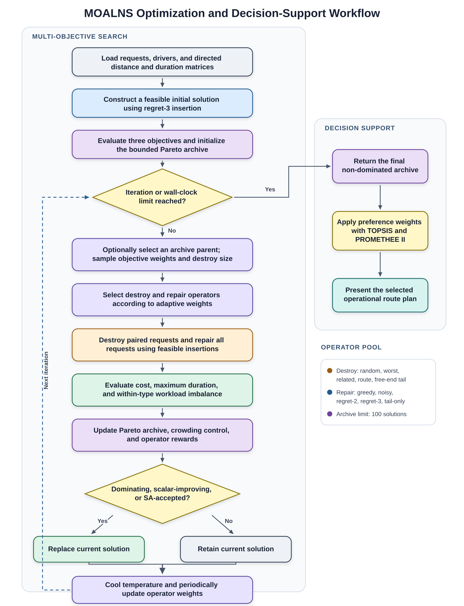

# Free-End Tail Reassignment for Multi-Objective Open PDVRP

Research code and manuscript artifacts for:

> **Free-End Tail Reassignment in Multi-Objective Adaptive Large Neighborhood
> Search for Heterogeneous Open Pickup-and-Delivery Routing**

This repository studies a heterogeneous, open pickup-and-delivery vehicle
routing problem without time windows. Routes start from driver-specific origins
and finish at their last service node; no return-to-depot edge is charged. The
proposed method is a multi-objective adaptive large neighborhood search
(MOALNS) with free-end tail removal and tail-only repair.

The optimization minimizes three criteria simultaneously:

1. total vehicle-specific operating cost;
2. maximum open-route duration (makespan); and
3. within-vehicle-type workload imbalance, including idle compatible drivers.

The experimental framework also contains NSGA-II, MOEA/D, and heuristic
epsilon-constraint baselines. TOPSIS and PROMETHEE II rank members of the final
Pareto archive after optimization; they do not modify routes or participate in
the algorithm comparison.



## Main contribution

In an open route, a zero-load boundary separates a self-contained suffix
without a return-to-depot edge. The proposed operators exploit that structure:

- **free-end tail removal** removes the largest admissible request suffix after
  an internal zero-load boundary, with a late-delivery fallback; and
- **tail-only repair** evaluates compatible drivers using append-only
  pickup-delivery insertion, without adding a terminal return edge.

The complete MOALNS uses five destroy operators (random, worst, related, route,
and tail) and five repair operators (greedy, noisy greedy, regret-2, regret-3,
and tail-only). Search is controlled by sampled augmented-Tchebycheff
preferences, simulated annealing, adaptive operator weights, archive-parent
restarts, and a crowding-controlled external Pareto archive.

## Repository layout

```text
PD VRP/
|-- data/                 instances, source data, and experiment manifests
|-- docs/                 methodology, protocols, and reference material
|-- outputs/              generated archives, metrics, tables, and figures
|-- paper/                manuscript versions, references, and paper figures
|   |-- figures/          SVG and 300-DPI flowchart assets
|   |-- sections/         reusable structured manuscript sections
|   `-- template/         IEEE Word template
|-- scripts/
|   |-- common/           shared PowerShell helpers
|   |-- data/             benchmark preparation
|   |-- experiments/      benchmarks and conference-scale experiments
|   |-- reporting/        paper tables, plots, and manuscript exports
|   |-- run/              small end-to-end workflows
|   |-- studies/          ablation and sensitivity analyses
|   `-- validation/       unit, independent, and exact validation
|-- src/                  Python solvers, analysis, and reporting code
|-- tests/                independent checker and open-route operator tests
|-- pdvrp.ps1             unified PowerShell entry point
|-- pyproject.toml
`-- requirements-core.txt
```

See [scripts/README.md](scripts/README.md) for the script map,
[docs/README.md](docs/README.md) for the technical documentation index, and
[outputs/README.md](outputs/README.md) for generated-artifact conventions.

## Environment setup

Run the following commands from PowerShell in the project root:

```powershell
py -m venv .venv
.\.venv\Scripts\python.exe -m pip install --upgrade pip
.\.venv\Scripts\python.exe -m pip install -r requirements-core.txt
```

Activation is optional because the runners prefer
`.venv\Scripts\python.exe` automatically and fall back to Python on `PATH`.
All scripts resolve paths from the repository root and can be called from any
working directory.

Run the source-level tests before starting experiments:

```powershell
.\.venv\Scripts\python.exe -m unittest `
  tests.test_independent_route_checker `
  tests.test_open_route_operators -v
```

List the unified runner tasks:

```powershell
.\pdvrp.ps1 help
```

## Quick start

Run MOALNS on the current heterogeneous instance and apply TOPSIS and
PROMETHEE II with the default preference weights:

```powershell
.\pdvrp.ps1 moalns -Iterations 5000 -TimeLimit 180 -Seed 42
```

Default single-run artifacts are written under `outputs/reports/`, including:

- `moalns_pareto_archive.csv`;
- `moalns_search_log.csv`;
- `moalns_solver_report.csv`;
- MODM rankings and selected route plans; and
- Pareto visualizations.

## Reproducing the conference experiments

### Equal-time algorithm comparison

The following command runs MOALNS, NSGA-II, MOEA/D, and heuristic
epsilon-constraint on the Current instance and nine 25-request
Li--Lim-derived instances, with three seeds and a 180-second wall-clock budget
per method:

```powershell
.\pdvrp.ps1 conference `
  -Manifest data/broader_instances_manifest.csv `
  -Seeds 42,43,44 `
  -TimePerMethod 180 `
  -Iterations 5000 `
  -PopulationSize 50 `
  -EpsilonLevels 5 `
  -OutputRoot outputs/broader_experiments `
  -PaperOutputRoot outputs/broader_paper
```

Completed algorithm archives are skipped. Use `-Force` only when an intentional
full rerun is required. To regenerate summaries without solving again:

```powershell
.\pdvrp.ps1 conference `
  -Manifest data/broader_instances_manifest.csv `
  -Seeds 42,43,44 `
  -OutputRoot outputs/broader_experiments `
  -PaperOutputRoot outputs/broader_paper `
  -AnalyzeOnly
```

### Tail-operator ablation

The paper's focused four-configuration ablation uses the full method and three
tail-removal variants:

```powershell
.\pdvrp.ps1 ablation `
  -Manifest data/instances_manifest.csv `
  -Seeds 42,43,44,45,46,47,48,49,50,51 `
  -Iterations 5000 `
  -TimeLimit 600 `
  -ConfigIds baseline,no_tail_removal,no_tail_repair,no_tail_operator
```

The runner also supports the broader operator ablation through its other
configuration identifiers. Use `-AnalyzeOnly` to rebuild statistics from
completed runs.

### Sensitivity and decision analysis

```powershell
# Time-budget sensitivity
.\pdvrp.ps1 time-sensitivity `
  -Seeds 42,43,44 `
  -TimeBudgets 60,180,600

# One-factor-at-a-time MOALNS parameter sensitivity
.\pdvrp.ps1 parameter-sensitivity `
  -Seeds 42,43,44 `
  -TimeLimit 120

# TOPSIS/PROMETHEE II weight-grid sensitivity
.\pdvrp.ps1 modm-sensitivity `
  -Archive outputs/reports/moalns_pareto_archive.csv `
  -GridStep 0.10
```

## Correctness validation

Three validation layers are provided.

### 1. Source-level regression tests

```powershell
.\.venv\Scripts\python.exe -m unittest `
  tests.test_independent_route_checker `
  tests.test_open_route_operators -v
```

These tests cover the independent checker and open-route insertion/tail
operator behavior.

### 2. Independent archive validation

The independent checker deserializes raw routes and recomputes request
coverage, duplicate events, same-driver pairing, precedence, compatibility,
capacity, open-route cost, duration, and all three objectives without calling
the solver's feasibility routine:

```powershell
.\pdvrp.ps1 validate-archives `
  -Manifest data/broader_instances_manifest.csv `
  -ExperimentsRoot outputs/broader_experiments `
  -OutputDir outputs/validation/broader_archive_check
```

### 3. Exact small-instance certificates

PuLP/CBC solves the minimum-cost specialization on generated small instances
and compares the proven optimum with ALNS and the minimum-cost MOALNS archive
member:

```powershell
.\pdvrp.ps1 exact-validation `
  -Sizes 4,6,8,10 `
  -Seeds 42,43,44 `
  -HeuristicTime 60 `
  -MilpTime 600
```

## Mathematical model and method documentation

- [Structured problem definition and MOALNS section](paper/sections/problem_and_moalns.md)
  contains assumptions, scope exceptions, sets, parameters, variables,
  objectives, constraints, operator descriptions, decision support, and the
  algorithm flowchart.
- [Mathematical model](docs/methodology/mathematical_model.md) contains the
  technical formulation notes.
- [MOALNS and MODM method](docs/methodology/moalns_modm_method.md) documents the
  algorithm design.
- [Experiment protocol](docs/methodology/experiment_protocol.md) and
  [sensitivity/ablation protocol](docs/methodology/sensitivity_and_ablation_runs.md)
  define the computational studies.
- [Operator audit](docs/methodology/operator_audit.md) records the free-end and
  insertion correctness checks.

## Paper artifacts

The current paper title is the one shown at the top of this README. Maintained
artifacts include:

| Artifact | Purpose |
|---|---|
| [`paper/manuscript_v2.docx`](paper/manuscript_v2.docx) | Six-page IEEE-style Word manuscript. |
| [`paper/manuscript_v2.pdf`](paper/manuscript_v2.pdf) | PDF export of the six-page manuscript. |
| [`paper/manuscript_v2.md`](paper/manuscript_v2.md) | Readable Markdown manuscript with the expanded structured model and method section. |
| [`paper/manuscript_v2.txt`](paper/manuscript_v2.txt) | UTF-8 plain-text export. |
| [`paper/main.tex`](paper/main.tex) | LaTeX draft and reproducible paper source. |
| [`paper/references.bib`](paper/references.bib) | BibTeX bibliography. |
| [`paper/references_ieee.txt`](paper/references_ieee.txt) | IEEE-formatted reference list. |
| [`paper/figures/moalns_flowchart.svg`](paper/figures/moalns_flowchart.svg) | Editable vector flowchart. |
| [`paper/figures/moalns_flowchart_300dpi.png`](paper/figures/moalns_flowchart_300dpi.png) | Word-ready 300-DPI flowchart. |

Regenerate the Markdown manuscript after changing its exported text or the
structured model/method fragment:

```powershell
.\scripts\reporting\export_manuscript_v2_markdown.ps1
```

Generate result tables and figures from completed experiments with:

```powershell
.\pdvrp.ps1 paper-outputs
```

## Data and reporting statement

The Li--Lim instances in `data/instances_extended/` are controlled
time-window-free derivatives. Time windows and service times were removed, and
the routing fleets were supplied by this study. Results must therefore be
reported as results on **derived open-PDVRP instances**, not as results on the
original PDPTW benchmark.

The Current instance is heterogeneous and uses driver-specific origins,
motorcycle/pickup compatibility, and directed OSRM road distances and travel
times. Generated results belong under `outputs/`; maintained code and manually
edited manuscript content must remain outside that directory.

## Practical deployment interpretation

In a real dispatch workflow, orders, drivers, capacities, compatibility, and
road matrices are loaded before planning. MOALNS returns several non-dominated
route plans rather than one opaque weighted solution. A dispatcher then selects
a plan using cost, completion-time, and workload-equity preferences through
TOPSIS or PROMETHEE II. The selected plan assigns every request to one
compatible driver, preserves pickup-before-delivery precedence and capacity,
and lets each driver finish at the final delivery location.
