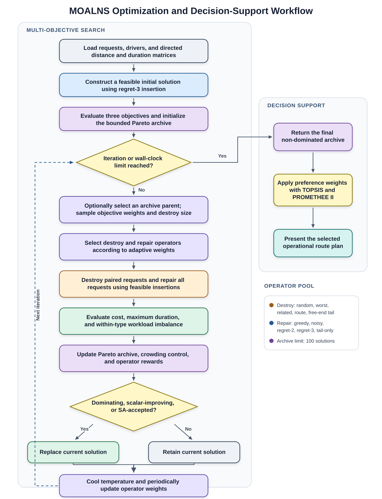

# Free-End Tail Reassignment in Multi-Objective Adaptive Large Neighborhood Search for Heterogeneous Open Pickup-and-Delivery Routing

**Abstract—** Open pickup-and-delivery routes have free endpoints that conventional closed-route neighborhoods do not exploit. We study a heterogeneous open pickup-and-delivery vehicle routing problem without time windows, minimizing operating cost, maximum route duration, and within-vehicle-type workload imbalance. We propose a multi-objective adaptive large neighborhood search with zero-load tail removal and tail-only compatible-driver repair. An objective-scope analysis shows that workload imbalance preserves 12.5–71.2% of empirical non-dominated alternatives lost under a two-objective projection. Across 160 paired ablation runs, the complete method improves normalized hypervolume by 2.13% over removing both tail operators and wins 27 of 40 blocks. Exact small-instance certificates and an independent checker validate implementation correctness. In a separate equal-time comparison across ten routing environments, the proposed method achieves the best aggregate hypervolume and significantly outperforms NSGA-II, MOEA/D, and heuristic epsilon-constraint baselines. The method provides an effective optimization tool for intelligent pickup-and-delivery transportation systems.
**Keywords—** pickup-and-delivery routing; intelligent transportation systems; multi-objective optimization; adaptive large neighborhood search; logistics optimization; workload equity

# Introduction
The pickup-and-delivery vehicle routing problem (PDVRP) underlies courier, retail, and on-demand logistics. Every request contains two linked service events: one vehicle must perform both the pickup and delivery, pickup must precede delivery, and vehicle capacity must hold along the route [1]. Practical dispatch adds heterogeneous vehicle compatibility, driver-specific origins, and routes that may end at the last customer rather than return to a depot.
That last feature changes neighborhood design. In a closed route, moving a suffix changes both its attachment edge and the return edge. In an open route, the terminal edge does not exist. A self-contained suffix cut at a zero-load boundary can therefore be removed and reassigned without paying a return-to-depot penalty. Generic removal and insertion operators can eventually produce such moves, but they do not target this structural opportunity.
Cost alone is also insufficient for many dispatch settings. A low-cost plan can leave one driver with a long completion time or concentrate work on a few workers. Conversely, balancing routes may require additional travel. We model these concerns by minimizing total operating cost, maximum route duration, and workload imbalance among drivers with the same vehicle capability. An a-posteriori method returns non-dominated alternatives before a dispatcher applies preferences.
Adaptive large neighborhood search (ALNS) is well suited to paired requests because destroy-repair moves can jointly change request assignment and both visit positions [3]. Multi-objective search additionally requires convergence and diversity [4]. We therefore develop a multi-objective ALNS (MOALNS) with changing augmented Tchebycheff preferences and an external Pareto archive.
The contributions are:
1. a three-objective formulation of a heterogeneous open PDVRP with driver-specific starts, vehicle compatibility, capacity, precedence, and workload equity within vehicle type;
2. a pair of open-route-specific operators--zero-load tail removal and tail-only compatible-driver repair--that explicitly exploit the free route endpoint;
3. an empirical objective-scope test showing that the equity objective preserves 12.5–71.2% of otherwise lost non-dominated alternatives on the tested fronts;
4. a reproducible validation chain comprising exact small-instance certificates, an independent route checker, a 160-run paired ablation demonstrating the contribution of each tail component, a 120-run equal-time comparison with NSGA-II, MOEA/D, and epsilon-constraint on ten environments, and time-, parameter-, and decision-weight sensitivity analyses.

# Related Work
The PDVRP couples request assignment with pickup--delivery precedence and capacity feasibility [1]. Li and Lim introduced widely used PDPTW benchmarks [2], while Ropke and Pisinger established ALNS as a strong solution framework [3]. Our setting removes time windows but adds driver-specific starts, heterogeneous compatibility, open endpoints, and three objectives.

Open VRP studies show that eliminating the depot return changes route structure [10], [11]. We transfer this free-end insight to paired-request suffixes. The broader pickup-and-delivery and ALNS literature supports problem-specific large neighborhoods and explicit operator testing [12], [13], [16]. Multi-objective routing motivates the cost, duration, and equity criteria and the NSGA-II, MOEA/D, and epsilon-constraint comparison [4]--[9].

# Problem Definition

## Assumptions and Scope Exceptions

The problem is static and deterministic: all requests, driver origins, vehicle characteristics, directed distances, and travel times are known before optimization. Each request is indivisible and consists of exactly one pickup and one delivery. Both events must be served by the same compatible driver, the pickup must precede the delivery, and vehicle capacity must be respected throughout the route. Each driver starts from a driver-specific origin and may serve at most one route. Distances and durations can be asymmetric.

Unlike the PDPTW, the studied problem has no time windows or service-time restrictions. Routes are open: a driver finishes at the last delivery and is not required to return to a depot. We represent this free endpoint by a driver-specific artificial sink with zero-cost and zero-time incoming arcs. Split deliveries, request transfers, multiple trips, dynamic arrivals, and stochastic travel times are outside the present scope. Strict vehicle compatibility is enforced, and the available fleet is assumed sufficient to construct at least one feasible solution. Workload equity is measured by the number of assigned requests within each vehicle type and includes idle compatible drivers.

## Sets and Indices

| Symbol | Definition |
|---|---|
| $R$ | Set of pickup-and-delivery requests, indexed by $r$. |
| $K$ | Set of drivers/vehicles, indexed by $k$. |
| $V$ | Set of vehicle types, indexed by $v$. |
| $K_v$ | Drivers having vehicle type $v$, where $K_v=\{k\in K:v_k=v\}$. |
| $P=\{p_r:r\in R\}$ | Set of pickup nodes. |
| $D=\{d_r:r\in R\}$ | Set of delivery nodes. |
| $N=P\cup D$ | Set of service nodes, indexed by $i,j$. |
| $s_k,e_k$ | Driver-specific start node and artificial end sink of driver $k$. |
| $N_k$ | Nodes available to driver $k$: $N_k=\{s_k\}\cup N\cup\{e_k\}$. |
| $A_k$ | Feasible directed arcs for driver $k$; arcs entering $s_k$ or leaving $e_k$ are excluded. |

## Parameters

| Symbol | Definition |
|---|---|
| $q_r$ | Demand of request $r$. |
| $Q_k$ | Capacity of driver $k$'s vehicle. |
| $v_r,v_k$ | Required vehicle type of request $r$ and vehicle type of driver $k$. |
| $a_{rk}$ | Compatibility indicator; one if driver $k$ may serve request $r$, and zero otherwise. |
| $d_{ij}$ | Directed travel distance from node $i$ to node $j$. |
| $\tau_{ij}$ | Directed travel time from node $i$ to node $j$. |
| $c_k$ | Operating cost per distance unit for driver $k$. |
| $b_i$ | Load change at node $i$: $b_{p_r}=q_r$, $b_{d_r}=-q_r$, and $b_{s_k}=b_{e_k}=0$. |
| $M$ | A sufficiently large sequencing constant. |

For every $i\in N$ and $k\in K$, arcs incident to an incompatible request can be omitted during preprocessing. Moreover, $d_{i e_k}=\tau_{i e_k}=0$ implements the free endpoint and prevents a hidden return-to-depot charge.

## Decision Variables

| Variable | Definition |
|---|---|
| $x_{ijk}\in\{0,1\}$ | One if driver $k$ traverses arc $(i,j)\in A_k$. |
| $y_{rk}\in\{0,1\}$ | One if request $r$ is assigned to driver $k$. |
| $h_k\in\{0,1\}$ | One if driver $k$ is used. |
| $u_{ik}\ge0$ | Visit position of node $i$ on driver $k$'s route. |
| $L_{ik}\ge0$ | Vehicle load immediately after visiting node $i$. |
| $T_k\ge0$ | Duration of driver $k$'s open route in minutes. |
| $T_{\max}\ge0$ | Maximum route duration over all drivers. |
| $n_k\ge0$ | Number of requests assigned to driver $k$. |

## Objectives

The problem minimizes the vector $F=(f_1,f_2,f_3)$:

$$
\min f_1=\sum_{k\in K}\sum_{(i,j)\in A_k}c_kd_{ij}x_{ijk},
$$

$$
\min f_2=T_{\max},
$$

$$
\min f_3=\frac{1}{|V|}\sum_{v\in V}
\sqrt{\frac{1}{|K_v|}\sum_{k\in K_v}(n_k-\bar n_v)^2},
\qquad
\bar n_v=\frac{1}{|K_v|}\sum_{k\in K_v}n_k.
$$

The first objective minimizes vehicle-specific operating cost. The second minimizes the makespan, thereby limiting the completion time of the longest route. The third minimizes the mean within-type standard deviation of assigned-request counts. Comparing drivers only within the same vehicle type avoids treating incompatible workloads as interchangeable; including idle drivers prevents concentrated assignments from appearing artificially balanced.

## Constraints

Every request is assigned exactly once and only to a compatible driver:

$$
\sum_{k\in K}y_{rk}=1, \qquad r\in R,
$$

$$
y_{rk}\le a_{rk}, \qquad r\in R,\ k\in K.
$$

Assignment is linked to exactly one incoming and one outgoing visit at both request nodes:

$$
\sum_{j:(p_r,j)\in A_k}x_{p_rjk}
=\sum_{i:(i,p_r)\in A_k}x_{ip_rk}=y_{rk},
\qquad r\in R,\ k\in K,
$$

$$
\sum_{j:(d_r,j)\in A_k}x_{d_rjk}
=\sum_{i:(i,d_r)\in A_k}x_{id_rk}=y_{rk},
\qquad r\in R,\ k\in K.
$$

Each used route leaves its driver-specific start once and enters its artificial sink once:

$$
\sum_{j:(s_k,j)\in A_k}x_{s_kjk}=h_k,
\qquad
\sum_{i:(i,e_k)\in A_k}x_{i e_k k}=h_k,
\qquad k\in K.
$$

Vehicle use and assignment are linked by

$$
h_k\le\sum_{r\in R}y_{rk}\le |R|h_k,
\qquad k\in K.
$$

The following sequencing constraints eliminate disconnected subtours and enforce pickup-before-delivery precedence:

$$
u_{jk}\ge u_{ik}+1-M(1-x_{ijk}),
\qquad (i,j)\in A_k,\ j\ne e_k,\ k\in K,
$$

$$
u_{p_rk}+1\le u_{d_rk}+M(1-y_{rk}),
\qquad r\in R,\ k\in K,
$$

$$
u_{s_k k}=0, \qquad k\in K.
$$

Load is propagated along every selected service arc and bounded by vehicle capacity:

$$
L_{jk}\ge L_{ik}+b_j-2Q_k(1-x_{ijk}),
\qquad (i,j)\in A_k,\ j\ne e_k,
$$

$$
L_{jk}\le L_{ik}+b_j+2Q_k(1-x_{ijk}),
\qquad (i,j)\in A_k,\ j\ne e_k,
$$

$$
0\le L_{ik}\le Q_k,\qquad L_{s_k k}=L_{e_k k}=0,
\qquad i\in N_k,\ k\in K.
$$

Finally, route durations, makespan, and request counts are defined by

$$
T_k=\frac{1}{60}\sum_{(i,j)\in A_k}\tau_{ij}x_{ijk},
\qquad T_{\max}\ge T_k,\qquad k\in K,
$$

$$
n_k=\sum_{r\in R}y_{rk},\qquad k\in K.
$$

The degree and start/end constraints create one open route for every used driver. Sequencing connects visited service nodes to that route and enforces precedence. Load propagation guarantees nonnegative loads and capacity feasibility. The last two equations provide the quantities used by the duration and equity objectives. The resulting formulation is a mixed-integer nonlinear multi-objective model because $f_3$ contains square roots; the implemented MOALNS evaluates the three objectives directly, while the PuLP/CBC certificate solves the $f_1$ specialization on small instances.

# Multi-Objective Adaptive Large Neighborhood Search

## Search Control

Following the ALNS framework [3], a solution is represented by one ordered pickup/delivery event sequence per driver; empty sequences represent idle drivers. Regret-3 insertion constructs an initial feasible solution. Its objective vector also provides positive scale values $g_m=\max\{1,f_m(s^0)\}$ for the three criteria.

At every iteration, MOALNS samples a weight vector $w$ from the three-dimensional simplex and evaluates a feasible solution $s$ using the augmented Tchebycheff scalarization

$$
\phi(s\mid w)=\max_{m\in\{1,2,3\}}
\left\{w_m\frac{f_m(s)}{g_m}\right\}
+\rho\sum_{m=1}^{3}w_m\frac{f_m(s)}{g_m},
\qquad \rho=0.05.
$$

Changing $w$ exposes different trade-off regions, while the augmented term helps distinguish solutions tied on the largest weighted deviation. With probability 0.35, an archive member replaces the current solution as the iteration parent; otherwise the current solution is retained. A destroy and a repair operator are sampled according to adaptive weights, and the destroy size is sampled from the configured interval.

The candidate is always considered for the external Pareto archive. Duplicate and dominated objective vectors are rejected, and vectors dominated by the candidate are removed. The archive is bounded at 100 solutions; if necessary, one member from the densest finite-crowding region is discarded. A candidate becomes the current solution if it dominates the current solution, improves the current scalar value, or passes simulated-annealing acceptance,

$$
P(\text{accept})=\exp\left(-\frac{\Delta}{\max(T,10^{-9})}\right),
\qquad \Delta=\phi(s'\mid w)-\phi(s\mid w).
$$

Operators receive rewards of 10 for adding a solution to the archive, 5 for producing a dominating candidate, and 1 for another accepted candidate. Every 15 iterations, each operator weight is updated as

$$
\omega_o\leftarrow(1-\lambda)\omega_o+
\lambda\frac{\pi_o}{\max(1,\nu_o)},
\qquad \lambda=0.25,
$$

where $\pi_o$ and $\nu_o$ are the operator's accumulated reward and usage count in the segment. The temperature is multiplied by 0.995 after each iteration. Search stops at the iteration or wall-clock limit and returns the non-dominated archive.

## Generic Destroy and Repair Operators

The generic destroy set contains four operators [3], [16]:

1. **Random removal** uniformly samples assigned requests.
2. **Worst removal** removes requests with the largest operating-cost saving when both events are deleted.
3. **Related removal** starts from a seed request and selects spatially related requests using pickup-to-pickup distance, delivery-to-delivery distance, and a vehicle-type incompatibility penalty.
4. **Route removal** selects a used driver and removes either its complete request set or a random subset up to the destroy size.

All destroy operators remove pickup and delivery jointly, so partial solutions cannot contain half-served requests. The generic repair set contains greedy, noisy greedy, regret-2, and regret-3 insertion. For each unassigned request, every compatible driver and every feasible pickup/delivery position pair is evaluated, including insertion after the current last event. Greedy selects the best scalarized insertion; noisy greedy perturbs its score to diversify search. Regret-$q$ prioritizes a request according to the loss incurred if its best insertion becomes unavailable, with $q\in\{2,3\}$. Route evaluation does not add a last-node-to-depot edge.

## Free-End Tail Operators

Consider route $k=(s_k,e_1,\ldots,e_h)$, and let $L_t$ be the load immediately after event $e_t$. A cut after position $t<h$ satisfying $L_t=0$ separates a self-contained suffix: every request picked before the cut is also delivered before it. The **tail-removal** operator enumerates such internal zero-load boundaries and removes the largest suffix whose number of requests does not exceed the sampled destroy size. When no admissible boundary exists, it falls back to removing requests having the latest delivery positions.

The **tail-only repair** operator tests only the append pattern

$$
(s_k,e_1,\ldots,e_h,p_r,d_r)
$$

over compatible drivers. Its incremental distance contains the edge from $e_h$ to $p_r$ and the pickup-to-delivery edge, but no return edge. Consequently, the destroy operator exposes a large capacity-safe suffix move, and the repair operator explicitly evaluates alternate free endpoints. Generic operators may reproduce an equivalent reassignment by chance, whereas this pair increases the frequency with which the search exploits the defining structure of an open route. The complete method therefore contains five destroy and five repair operators.

## Decision Support

MOALNS first generates feasible non-dominated routes without imposing a final decision-maker preference. TOPSIS [14] and PROMETHEE II [15] are subsequently applied to normalized cost, maximum-duration, and workload-imbalance values using a user-specified weight vector. TOPSIS is compensatory and ranks alternatives by relative distance from ideal and anti-ideal points. PROMETHEE II is an outranking method based on pairwise preference flows. Both methods rank existing archive members only; they neither modify routes nor affect the optimization comparison.

## Algorithm Flowchart

**Figure 1.** MOALNS optimization and post-optimization decision-support workflow.

# Experimental Design

## Instances and Protocol
The Current instance contains 27 requests and nine drivers (six motorcycles and three pickup trucks), driver-specific origins, and directed OSRM road distances and durations. Three ablation instances retain 12 requests from the clustered LC101, random LR101, and mixed LRC101 Li-Lim families [2]. The broader comparison uses nine 25-request derivatives: LC102, LC105, LC201, LR102, LR105, LR201, LRC102, LRC105, and LRC201. In every derivative, time windows and service times are removed and four homogeneous vehicles are supplied. These are controlled no-time-window derivatives, not results on the original PDPTW benchmarks.
The ablation compares the full method with removal of tail destroy, tail repair, and both. Each configuration uses seeds 42-51, 5,000 maximum iterations, and 600 seconds per instance-seed run. This gives 4×4×10=160 runs. All configurations share initialization, scalarization, generic operators, acceptance, adaptation, and archive settings. 
For normalized hypervolume (HV), all relevant archives in an instance-seed block use common componentwise bounds and reference point ,1.1,1.1,1.1.; higher is better [8]. We also report archive size, spacing, and contribution to the empirical union front. Paired differences use two-sided Wilcoxon signed-rank tests with Holm correction over the three predeclared tail ablations.

## Implementation Validation
Validation is deliberately independent of the solver's feasibility functions. The checker deserializes raw routes and separately verifies coverage, duplicate events, same-driver pairing, precedence, compatibility, capacity, open-route distance, duration, and all three reported objectives.
A PuLP/CBC arc-flow model supplies exact cost certificates on three four-request instances. These small cases test formulation and implementation; they are not evidence of large-instance performance.

## External Comparison
The production benchmark compares tail-enabled MOALNS with route-based NSGA-II, MOEA/D, and heuristic epsilon-constraint. All methods use the same route representation, feasibility evaluator, objective functions, initial construction, and wall-clock limit. NSGA-II applies non-dominated sorting, crowding distance, route inheritance, and destroy-repair mutation with a population of 50. MOEA/D uses 50 simplex weights, five-neighbor scalar subproblems, route crossover, and destroy-repair mutation. Epsilon-constraint minimizes cost while bounding duration and imbalance on a 5×5 grid; it is a heuristic baseline rather than exact AUGMECON.
The external comparison uses the Current instance and nine 25-request derivatives, seeds 42-44, and an equal 180-second wall-clock limit: 10×3×4=120 runs. Fixed per-instance normalization bounds are pooled across every algorithm and seed. We report normalized HV, spacing, archive size, empirical coverage, and contribution to the instance-seed union front.
The omnibus comparison uses a Friedman test over 30 paired instance-seed blocks. Because repeated seeds from one instance are not independent routing environments, the primary confirmatory analysis first averages seeds within each instance and applies a Friedman test to ten independent instance means. Six pairwise Wilcoxon tests on these means use Holm correction. Block-level tests are retained as supporting stochastic-run analyses.

## Sensitivity and Decision Analysis
Time-budget sensitivity uses the three 12-request derivatives, seeds 42-44, and limits of 60, 180, and 600 seconds. One-factor-at-a-time parameter sensitivity evaluates the baseline and 17 alternatives on the same three instances and seeds under 120-second limits, giving 162 runs. The factors are destroy size, archive size, archive-parent probability, reaction factor, cooling, initial temperature, adaptation-segment length, and augmented Tchebycheff parameter ρ.
Finally, TOPSIS and PROMETHEE II are applied to the feasible Current-instance archive over 231 simplex-grid weight vectors. We report selection agreement, the number of distinct selected plans, and the objective ranges induced by preference changes. This layer ranks existing routes only; it does not enter algorithm-performance testing.

# Results

## Does the Third Objective Add Information?
For each instance, all unique archive vectors are filtered in three dimensions and then projected onto cost-maximum-duration. A vector that becomes dominated after projection was non-dominated only because of workload imbalance. Across the tested environments, 12.5–71.2% of the three-objective front is lost under the two-objective projection. At least one point is lost in every instance. Imbalance therefore adds information throughout the test set, although its contribution is much stronger on Current and the LC and LRC105 derivatives than on LRC102 and LRC201.

Spearman coefficients on Pareto points are descriptive rather than population-level tests because front points are dependent. Cost-duration correlations range from -0.527 to -0.992 on the all-algorithm fronts, while cost-imbalance correlations range from -0.911 to -1.000. Strong correlation does not make an objective redundant: the projection test directly counts vectors whose status depends on imbalance and is consequently the primary objective-scope evidence.

## Exact and Independent Validation
CBC proved cost optimality on three four-request instances, and both ALNS and the minimum-cost MOALNS archive member attained zero gap. The independent checker verified all 3,584 ablation and 933 production archive solutions without a feasibility or objective mismatch.

## Tail-Operator Ablation
**Table I. Tail-operator ablation over 40 paired instance-seed blocks.**

| Configuration | Mean HV | Archive | Mean ΔHV | W–T–L | Holm-adjusted *p* |
|---|---:|---:|---:|---:|---:|
| Full MOALNS | 0.67936 | 26.25 | — | — | — |
| No tail repair | 0.67267 | 21.90 | −0.00670 | 7–9–24 | 0.002976 |
| No tail removal | 0.66928 | 21.55 | −0.01008 | 6–10–24 | 0.000712 |
| No tail operators | 0.66522 | 19.90 | −0.01414 | 4–9–27 | 1.96 × 10⁻⁴ |
Removing both tail operators reduces mean HV by 0.01414; equivalently, the full method improves the mean of HV by 2.13% relative to the joint ablation. Mean archive size increases from 19.90 to 26.25 (31.9%), and empirical union-front contribution increases from 408 to 712 (74.5%). The full method wins 27 blocks, ties nine, and loses four. The adjusted test is significant.
Both components matter independently. Removing tail removal produces the larger mean loss, while removing tail repair also causes a significant decrease. The joint loss is smaller than the sum of individual losses, which is consistent with partial overlap: generic operators can occasionally reproduce a tail move, but not with the same search frequency.

The benefit is instance dependent. The largest absolute gain over the joint ablation is on Current (0.04337 HV), followed by LC101-12 (0.00744) and LR101-12 (0.00566). LRC101-12 is nearly invariant across configurations and contributes little discrimination. This pattern supports the structural argument: tail reassignment is most useful when heterogeneous assignments and driver-specific starts create meaningful endpoint choices.

## External Algorithm Comparison
In the broader benchmark, MOALNS has the highest mean HV on nine of ten instances; NSGA-II leads on LRC201-25. Relative standard deviations are large on several derivatives because only three seeds are available, so inference is based on paired instance means rather than on the aggregate mean alone.

Aggregating the 30 paired blocks, MOALNS obtains the highest mean HV (0.4233), best mean rank (1.8000), most first-place results (17), largest mean archive (8.83), and largest empirical union-front contribution (185).
NSGA-II has the smallest spacing, illustrating why spacing alone is not a convergence measure: its mean HV is the lowest.

**Table II. Aggregate performance across 30 instance-seed blocks.**

| Method | Mean HV | Mean HV rank | Wins | Mean archive size | Union-front contribution |
|---|---:|---:|---:|---:|---:|
| MOALNS | 0.4233 | 1.8000 | 17 | 8.83 | 185 |
| MOEA/D | 0.2043 | 2.7000 | 3 | 6.30 | 67 |
| NSGA-II | 0.1856 | 3.1667 | 3 | 7.77 | 74 |
| Epsilon-constraint | 0.2355 | 2.3333 | 7 | 8.20 | 100 |
The Friedman test on the ten independent instance means rejects equal performance ({\chi }^{2}=15.48, p=0.00145). At the instance level, MOALNS exceeds MOEA/D on all ten instances and exceeds NSGA-II and epsilon-constraint on nine. All three comparisons remain significant after Holm correction. The supporting block-level analysis reaches the same conclusion ({\chi }^{2}=18.04, p=4.32\times {10}^{-4}); adjusted pairwise p-values are 2.20\times {10}^{-4}, 5.53\times {10}^{-5}, and 0.01195, respectively.
Coverage supports the same interpretation. On average, MOALNS dominates 35.0% of MOEA/D, 37.7% of NSGA-II, and 33.5% of epsilon archive members.
The reverse coverages are 21.4%, 16.9%, and 18.9%, respectively. These nonzero reverse values prevent a claim of universal dominance.
Mean runtimes are 180.024, 180.045, 180.037, and 180.040 seconds for MOALNS, MOEA/D, NSGA-II, and epsilon-constraint. The independent checker recomputes all constraints and objectives for 933 production archive members; all 933 pass.

## Sensitivity and Decision Support
Mean HV rises from 0.6700 at 60 s to 0.7373 at 180 s and 0.7525 at 600 s; both shorter budgets differ from 600 s after Holm correction (p=0.00781). None of 17 parameter variants differs significantly from the baseline after correction, although removing Tchebycheff augmentation yields the largest mean loss. Across 231 weight vectors, TOPSIS and PROMETHEE II agree on 41.1% of selections and choose 16 and 10 distinct plans, respectively, confirming that deployment is preference dependent.

# Conclusion and Limitations
This study introduces free-end tail removal and tail-only repair for a three-objective heterogeneous open PDVRP. Workload imbalance preserves 12.5--71.2% of empirical alternatives lost under a cost--duration projection, while paired ablation confirms that the tail operators improve hypervolume and archive diversity. MOALNS achieves the best aggregate HV in the equal-time comparison and significantly outperforms all three baselines on independent instance means. Limitations include three production seeds, nine time-window-free derivatives, one heterogeneous road-network instance, and shared implementation components across algorithms. Future work should evaluate larger independent benchmarks, alternative equity measures, and dynamic travel conditions.

# References
[1] M. W. P. Savelsbergh and M. Sol, “The general pickup and delivery problem,” Transportation Science, vol. 29, no. 1, pp. 17–29, 1995, doi: 10.1287/trsc.29.1.17.
[2] H. Li and A. Lim, “A metaheuristic for the pickup and delivery problem with time windows,” International Journal on Artificial Intelligence Tools, vol. 12, no. 2, pp. 173–186, 2003, doi: 10.1142/S0218213003001186.
[3] S. Ropke and D. Pisinger, “An adaptive large neighborhood search heuristic for the pickup and delivery problem with time windows,” Transportation Science, vol. 40, no. 4, pp. 455–472, 2006, doi: 10.1287/trsc.1050.0135.
[4] N. Jozefowiez, F. Semet, and E.-G. Talbi, “Multi-objective vehicle routing problems,” European Journal of Operational Research, vol. 189, no. 2, pp. 293–309, 2008, doi: 10.1016/j.ejor.2007.05.055.
[5] K. Deb, A. Pratap, S. Agarwal, and T. Meyarivan, “A fast and elitist multiobjective genetic algorithm: NSGA-II,” IEEE Transactions on Evolutionary Computation, vol. 6, no. 2, pp. 182–197, 2002, doi: 10.1109/4235.996017.
[6] Q. Zhang and H. Li, “MOEA/D: A multiobjective evolutionary algorithm based on decomposition,” IEEE Transactions on Evolutionary Computation, vol. 11, no. 6, pp. 712–731, 2007, doi: 10.1109/TEVC.2007.892759.
[7] G. Mavrotas, “Effective implementation of the epsilon-constraint method in multi-objective mathematical programming problems,” Applied Mathematics and Computation, vol. 213, no. 2, pp. 455–465, 2009, doi: 10.1016/j.amc.2009.03.037.
[8] E. Zitzler and L. Thiele, “Multiobjective evolutionary algorithms: A comparative case study and the strength Pareto approach,” IEEE Transactions on Evolutionary Computation, vol. 3, no. 4, pp. 257–271, 1999, doi: 10.1109/4235.797969.
[9] P. Matl, R. F. Hartl, and T. Vidal, “Workload equity in vehicle routing problems: A survey and analysis,” Transportation Science, vol. 52, no. 2, pp. 239–260, 2018, doi: 10.1287/trsc.2017.0744.
[10] D. Sariklis and S. Powell, “A heuristic method for the open vehicle routing problem,” Journal of the Operational Research Society, vol. 51, no. 5, pp. 564–573, 2000, doi: 10.2307/254187.
[11] J. Brandão, “A tabu search algorithm for the open vehicle routing problem,” European Journal of Operational Research, vol. 157, no. 3, pp. 552–564, 2004, doi: 10.1016/S0377-2217(03)00238-8.
[12] D. Pisinger and S. Røpke, “A general heuristic for vehicle routing problems,” Computers & Operations Research, vol. 34, no. 8, pp. 2403–2435, 2007, doi: 10.1016/j.cor.2005.09.012.
[13] S. N. Parragh, K. F. Doerner, and R. F. Hartl, “A survey on pickup and delivery problems. Part II: Transportation between pickup and delivery locations,” Journal für Betriebswirtschaft, vol. 58, no. 2, pp. 81–117, 2008, doi: 10.1007/s11301-008-0036-4.
[14] C.-L. Hwang and K. Yoon, Multiple Attribute Decision Making: Methods and Applications—A State-of-the-Art Survey, Lecture Notes in Economics and Mathematical Systems, vol. 186. Berlin, Germany: Springer, 1981, doi: 10.1007/978-3-642-48318-9.
[15] J.-P. Brans and P. Vincke, “Note—A preference ranking organisation method,” Management Science, vol. 31, no. 6, pp. 647–656, 1985, doi: 10.1287/mnsc.31.6.647.
[16] S. Voigt, “A review and ranking of operators in adaptive large neighborhood search for vehicle routing problems,” European Journal of Operational Research, vol. 322, no. 2, pp. 357–375, 2025, doi: 10.1016/j.ejor.2024.05.033.
